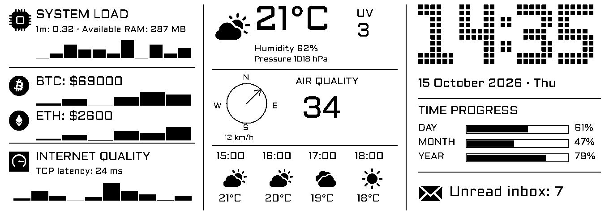

# Waveshare 10.85″ dashboard — Go

A native Go rewrite of [czuryk/Waveshare-ePaper-10.85-dashboard](https://github.com/czuryk/Waveshare-ePaper-10.85-dashboard). One executable fetches the data, renders the 1360×480 monochrome dashboard, and drives the panel over Linux GPIO/SPI. Fonts, icons, and timezone data are embedded. No Python runtime is needed.



The preview uses **example data**, not live readings.

## Run locally

Requires Go 1.26 or newer. Preview mode works without Raspberry Pi hardware.

```sh
go build -o bin/dashboard ./cmd/dashboard
./bin/dashboard -demo -once -output dashboard.png
cp dashboard.example.json dashboard.json
./bin/dashboard -config dashboard.json -once -output dashboard.png
```

Without `-once`, providers poll independently and the image updates every minute. `-demo` makes no network requests. For a live run, weather, air quality, cryptocurrency, Linux system metrics, and the internet probe work without credentials. `/proc` system metrics are unavailable on macOS/Windows and show an unavailable state.

## Integrations

All original widget integrations have Go implementations:

| Integration | Implementation | Configuration / credentials |
| --- | --- | --- |
| Weather + European AQI | Open-Meteo; current conditions and next four hours; high UV/AQI inversion | Latitude, longitude, timezone |
| Strava | Paginated activities, total and current/previous year cycling, hiking/walking totals | `strava: true`; `-auth strava` or existing `strava_token.json` |
| Bambu Lab | Persistent local TLS MQTT subscription; status, progress, remaining time, layers | `bambu.enabled`, host, serial, access code |
| Roborock | Native V1 cloud login, discovery, encrypted MQTT `get_status`; battery, cleaned area and persistent last-clean reference | `roborock.enabled`, email, optional device ID; `-auth roborock` |
| Spotify via Last.fm | Current track, artist, monochrome album art, paused state | `spotify.enabled`, Last.fm API key and username |
| Gmail | Unread count for the INBOX label, matching the original implementation | `gmail: true`; `-auth gmail` or existing Google `token.json` |
| Claude | OAuth token refresh; five-hour and weekly usage | `claude: true`; `-auth claude` or `claude_creds.json` |
| Codex | Existing CLI credentials, refresh/rotation, account-scoped usage; windows labeled by their duration | `codex: true`; copy `auth.json` into the state directory |
| Antigravity | OAuth refresh, model quotas and reset times | `antigravity: true`; `-auth antigravity` or `antigravity_creds.json` |
| Fallbacks | Linux load average + available RAM, BTC/ETH history, TCP internet latency, day/month/year progress | Defaults |

Widget placement preserves the original priorities: Strava replaces system load; Bambu replaces crypto; Roborock, Antigravity, and Codex take precedence over the internet widget in that order; Claude takes precedence over Spotify and time progress. Enabled providers still poll independently. Antigravity cycles through available model quotas instead of hard-coding model names.

Load average is labeled as load, not incorrectly presented as CPU percent. The internet probe measures a TCP handshake to `1.1.1.1:443`, not ICMP, so no ping executable or raw-socket privileges are needed. UV comes from the current hourly forecast. Forecast times and year boundaries use the configured timezone.

## Configuration and authentication

`dashboard.example.json` contains every setting. Credentials and local `dashboard.json` are ignored by Git. Relative `state_dir` paths resolve beside the configuration file. Existing Python token JSON files can be copied into that directory. Roborock's Python pickle is **not** loaded: run its Go login once to create `roborock_session.json`.

```sh
# Enable/configure the desired provider in dashboard.json, then authorize it:
./bin/dashboard -config dashboard.json -auth strava
./bin/dashboard -config dashboard.json -auth gmail
./bin/dashboard -config dashboard.json -auth claude
./bin/dashboard -config dashboard.json -auth antigravity
./bin/dashboard -config dashboard.json -auth roborock
```

Strava and Gmail ask for your OAuth application client ID/secret. The other flows retain the original application's OAuth client settings. Open the printed URL, approve access, and paste the complete localhost callback URL; the dashboard validates OAuth state. The CLI uses PKCE for Gmail and Claude. Gmail requires an installed/desktop OAuth application with loopback redirects and the Gmail API enabled. Codex login remains external: supply the existing CLI `auth.json` in the state directory; the dashboard does not open a separate Codex login flow.

Credentials are atomically replaced with mode `0600` when refreshed. Token files must be writable by the dashboard user. A daemon run never prompts for authentication. Provider failures appear in logs and preserve the previous reading with a stale indicator; an unfetched reading is shown as unavailable rather than zero.

Bambu printers commonly use a self-signed LAN certificate. Set `bambu.insecure_tls: true` to accept that certificate, as the original Python client did. It is off by default; the setting applies only to the Bambu MQTT connection.

Roborock supports the same V1 vacuum family used by the original dashboard (`v1_properties`). A01/B01 devices and Mi Home authentication are not supported. Use the device ID printed by `-auth roborock` if you have multiple vacuums. Re-run authentication to rediscover devices or replace an expired/revoked cloud session.

## Raspberry Pi

Enable SPI using `raspi-config`. Both SPI chip selects are required: `/dev/spidev0.0` and `/dev/spidev0.1`. The service user needs access to the `spi` and `gpio` groups.

Default BCM GPIO lines: reset 17, data/command 25, busy 24, power 18. Chip selects use the SPI devices (CE0 / CE1). `gpio_chip` defaults to `gpiochip0`; set it to the controller exposing those BCM lines on your board. All paths and control-line offsets are configurable. Orange Pi requires its own GPIO offsets and SPI paths; Raspberry Pi values must not be assumed to apply.

Cross-compile on a development computer:

```sh
make pi-zero       # Linux ARMv6: Pi Zero 1 W; also works on 32-bit Zero 2 OS
make pi-zero2      # Linux ARM64: Pi Zero 2 W with 64-bit OS
```

Copy the matching executable and configuration to the Pi. No font/icon directories or shared libraries are needed.

```sh
./dashboard -config dashboard.json -display -output dashboard.png
```

The first frame uses a full refresh; subsequent frames use partial refreshes. The default full-refresh interval is 600 frames. Old/new RAM is written for both 680×480 controllers, preserving the original partial-refresh fix. Single-core systems automatically reset before each partial frame; `panel.reinit_each_frame` can override this behavior. BUSY waits and refresh operations have deadlines. A panel error exits with a nonzero status so systemd can restart cleanly; SIGINT/SIGTERM stop workers and attempt panel sleep/power-off.

### Run as a service

An example service is in [`deploy/dashboard.service`](deploy/dashboard.service). It expects an `epaper` user, `/opt/epaper-dashboard/dashboard`, and `/opt/epaper-dashboard/dashboard.json`. Configure `state_dir` as `/var/lib/epaper-dashboard` and perform login as the service user before starting it.

```sh
sudo useradd --system --user-group --home-dir /var/lib/epaper-dashboard epaper
sudo usermod -aG gpio,spi epaper
sudo install -d -o epaper -g epaper /var/lib/epaper-dashboard
sudo install -d /opt/epaper-dashboard
sudo install -m 0755 bin/dashboard-linux-armv6 /opt/epaper-dashboard/dashboard
sudo install -o epaper -g epaper -m 0600 dashboard.json /opt/epaper-dashboard/dashboard.json
sudo install -m 0644 deploy/dashboard.service /etc/systemd/system/dashboard.service
sudo systemctl daemon-reload
sudo systemctl enable --now dashboard
journalctl -u dashboard -f
```

Use the ARM64 binary in the install command if the Pi runs a 64-bit OS. Group names and GPIO chip selection depend on the installed distribution.

## Development and verification

```sh
make test          # race-enabled unit tests and go vet
make build
make preview
make pi-zero
make pi-zero2
```

Tests cover OAuth refresh/rotation and state validation, provider parsing, timezone boundaries, concurrent snapshots, malformed Roborock frames, monochrome rendering, all bundled icon formats, controller buffer splitting, and old/new RAM updates. CI runs the tests and cross-builds.

The implementation has been tested using mocked APIs, an emulated display bus, and offline previews. **Physical panel, printer/vacuum, and authenticated account verification are still required.** Private Claude/Codex/Antigravity endpoints and device firmware behavior may change. This is a reviewable rewrite, not a claim of hardware-certified parity.

Code is organized under `cmd/dashboard`, `internal/config`, `internal/model`, `internal/providers`, `internal/render`, and `internal/display`. The original Python files remain for reference and rollback; their original setup instructions are in [`docs/python-reference.md`](docs/python-reference.md). They are not invoked by the Go application.

See [`NOTICE.md`](NOTICE.md) for source attribution and third-party notices.
